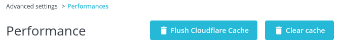
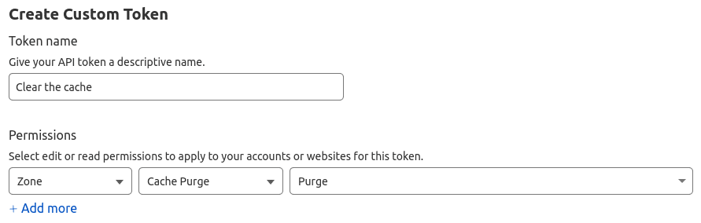

# Prestashop Cloudflare

[](https://php.net/)
[](https://www.prestashop.com)
[](https://github.com/Pixel-Open/prestashop-cloudflare/releases)

## Presentation

Cloudflare API features in Prestashop:

- Clear Cloudflare Cache in the Prestashop admin
- Enable the Cloudflare "I'm Under Attack" mode for a limited time (admin page and CLI commands), with excluded paths



## Requirements

- Prestashop >= 1.7.7.0 / Prestashop >= 8.0 / Prestashop >= 9.0
- PHP >= 7.2.0
- A system cron task, every 5 minutes, to automatically disable the Under Attack mode

```
*/5 * * * * php /path/to/prestashop/bin/console pixel_cloudflare:under-attack:expire
```

## Installation

Download the **pixel_cloudflare.zip** file from the [last release](https://github.com/Pixel-Open/prestashop-cloudflare/releases/latest) assets.

### Admin

Go to the admin module catalog section and click **Upload a module**. Select the downloaded zip file.

### Manually

Move the downloaded file in the Prestashop **modules** directory and unzip the archive. Go to the admin module catalog section and search for "Cloudflare".

## Configuration

From the module manager, find the module and click on configure.

### Settings

| Field                | Description                                                        | Required |
|:---------------------|:-------------------------------------------------------------------|----------|
| Zone ID              | The website Zone ID                                                | Y        |
| Authentication mode  | The authentication mode: API Token or Global API key               | Y        |
| API Token *          | A valid token from your Cloudflare Account, restricted to the zone | Y        |
| Global API Key       | The Cloudflare Global API key                                      | Y        |
| Account Email        | Email address associated with your Cloudflare account              | Y        |

### Token

\* For an API Token authentication (more secure), create a new custom API token restricted to the zone ("Zone Resources: Include - Specific zone"), with permissions on:

- **DND & Zones > Zone:** Read
- **Rules & Configuration > Config Rules:** Read & Write
- **Analytics & Logs > Analytics:** Read
- **Cache & Performance > Cache Purge:** Purge

On save, the API access is checked and the excluded paths are pushed to the existing Under Attack rule.

### Under Attack mode

| Field                      | Description                                                                                                                                                           | Default |
|:---------------------------|:----------------------------------------------------------------------------------------------------------------------------------------------------------------------|---------|
| Default duration (minutes) | Duration selected by default in the admin page and used by the CLI command without `--duration`                                                                       | 120     |
| Maximum duration (minutes) | Maximum allowed duration                                                                                                                                              | 1440    |
| Allow known bots           | Never challenge the bots known by Cloudflare (`cf.client.bot`: Googlebot, Bingbot...). **Not available on the Cloudflare Free plan**: the activation is refused       | No      |
| Excluded paths             | One path per line, never challenged (server-to-server calls: webservice, payment notifications...). `*` matches any characters. Allowed: letters, digits, `/ _ - . *` | See below |

Default excluded paths:

```
/api/*
*/module/*/*webhook*
*/module/*/*ipn*
*/module/*/*notification*
```

Adapt them to the payment modules installed on the shop (the URL path is case-insensitive, `*` also matches the language code, e.g. `/fr/module/...`).



## Under Attack mode

When enabled, every visitor goes through a Cloudflare check page (a few seconds) before accessing the site, which blocks the massive traffic of bots that do not run JavaScript. To be used only during an attack, for a limited time.

### Admin

In admin, go to *Advanced Parameters > Cloudflare Under Attack*

### CLI

```bash
# Enable for the default duration, or for a given duration in minutes
php bin/console pixel_cloudflare:under-attack:enable
php bin/console pixel_cloudflare:under-attack:enable --duration=60

# Disable
php bin/console pixel_cloudflare:under-attack:disable

# Status
php bin/console pixel_cloudflare:under-attack:status
```

### Automatic deactivation (cron)

The mode is automatically disabled at the end of the chosen duration. Add the expiration command to the system crontab, every 5 minutes:

```
*/5 * * * * php /path/to/prestashop/bin/console pixel_cloudflare:under-attack:expire
```

## Logs

Every action is logged in *Advanced Parameters > Logs* (object type `pixel_cloudflare`).

## Clear the cache

In admin, go to *Advanced settings > Performance*

- Clear only Cloudflare cache with the button: **Clear Cloudflare Cache**
- Clear prestashop and Cloudflare cache with the button: **Clear cache**
